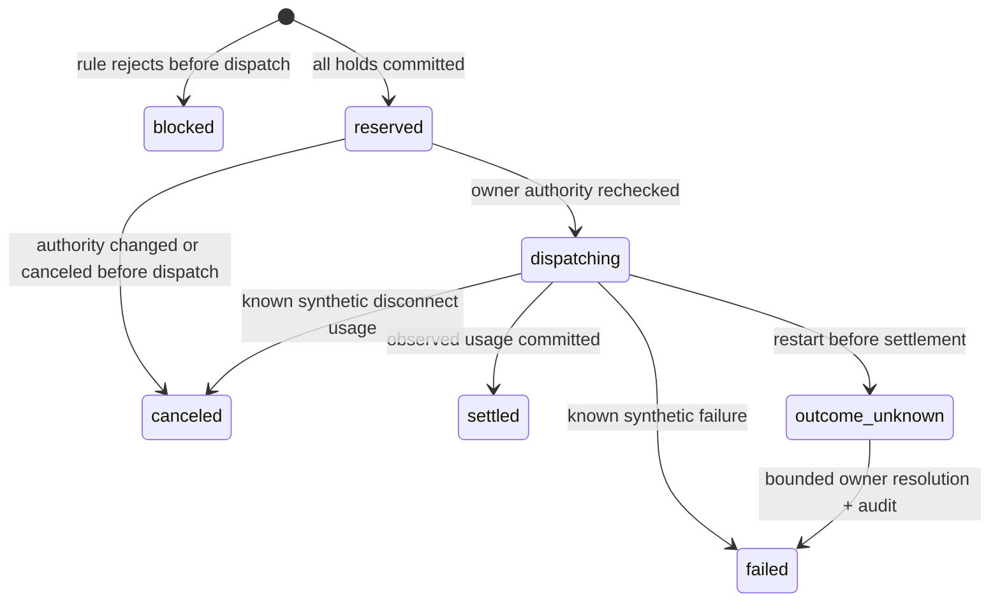

# ADR-001: One local authority, shared admission rules, owned asynchronous work

Status: Accepted for local release 0.2.0. Date: 22 October 2026.

## Context

Additional spending is INR 0. The available host is a Windows laptop. There is no live provider integration, external database or public deployment. Correct accounting under concurrency, interrupted requests and restart matters more than service count or framework breadth.

## Decision

Use one FastAPI process, a local SQLite WAL database, and a static frontend with no build server. Separate business rules from persistence and reporting. Keep the original commercial/educational backlog outside the runnable release.

- `models.py`: strict request shapes and bounds; no provider URLs or credentials.
- `policy.py`: pure rule ordering shared by admission and advisory preview. It receives current counters, scope balances and immutable session policy; it performs no I/O.
- `store.py`: SQLite authority, schema version 1, short write transactions, reservations, settlements, reconciliation, recovery, backups and integrity.
- `reporting.py`: snapshot reads for preview, searchable pagination, full receipts and current-admission-month insights. Reports never dispatch or authorize work.
- `engine.py`: simulator execution, streaming, bounded laboratory orchestration and cancellation-safe ownership of database threads.
- `runtime.py`: operating-system lock, one server owner per data directory.
- `app.py`: authentication, host/origin/body guards, routes and response contracts.
- `static/`: owner interface, keyboard-accessible receipt buttons, advisory preview, usage attribution and explicit simulation labels.

## Admission and orchestration

1. Validate request shape, workload identity, session label and context bounds.
2. In a database worker thread, start `BEGIN IMMEDIATE`. Load current owner policy, key policy, immutable session policy and parent/month/session buckets.
3. Check pause, model permissions, session status/age/calls/repetition, concurrency, RPM and every budget. Commit either a blocked receipt or all applicable holds. A new session cannot bypass a parent ceiling.
4. Revalidate pause/revocation at dispatch. Commit dispatch state before generation, then run the deterministic provider outside transactions.
5. Settle observed synthetic usage once, release unused exposure and append the ledger entry in one transaction. Owner reconciliation also writes its evidence note in this same transaction.
6. A caller cancellation waits for its database thread to finish. A reservation whose caller was canceled before dispatch is canceled at zero cost. No abandoned thread can create an untracked hold later.
7. A lab batch owns all its children. Unexpected failure or parent cancellation cancels and awaits children before the batch lock is released. There are no automatic retries or background orphan batches.

If storage fails after dispatch, the original hold remains. Restart conservatively marks outstanding dispatched work uncertain; storage failure is never evidence of zero usage. The synthetic engine knows emitted units; that does not establish billing semantics for any future real provider.

## Reporting semantics

Preview reads one WAL snapshot and creates no session, receipt, event or hold. It is a one-request explanation at a point in time. It is not a reservation or a batch prediction; actual admission rechecks authority and balances. Editing the lab input invalidates the displayed estimate.

Integrity reads balances, requests and ledger from one snapshot. It checks aggregate totals, per-request ledger amounts, missing referenced scopes and retained holds. Concurrent writers continue under WAL. This is an application consistency check, not a cryptographic audit against a database administrator.

Usage insights select requests by their snapshotted organization admission month, including late settlement into that original period. Group totals are limited to the leading 20 clients/workloads/models and labeled accordingly. Released allowance is an unused authorization, not verified money saved. Overview activity counts and the request log span retained history; the spending ceiling is the current UTC month.

Search filters run on all retained history with bound SQL parameters. Count and page rows share a snapshot. Pagination has stable ordering within that read; concurrent new records can shift offset-based pages between refreshes. Full receipts are fetched by ID, independently of the latest-100 overview sample.

## Alternatives and consequences

Splitting services, adding Redis/Kubernetes or adopting a hosted database would add processes, deployment work and failure boundaries without validating this product. Keep these out of the local release. SQLite permits one writer at a time; this design is not a multi-instance gateway. Move to a separately engineered shared authority only when a real pilot needs it.

Duplicating preview rules would drift from enforcement. The pure evaluator shares ordering while persistence remains explicit. Admission can mutate and commit; preview loads virtual empty session/bucket defaults without mutation. Regression tests compare relevant outcomes and prove preview changes no persisted state.

Adding a live upstream now would require billing bounds, tokenizer/pricing semantics, provider credentials and usage-reconciliation tests. Those concerns are deliberately absent. A future adapter must pass contract/failure tests before it can claim to protect real provider spending.

## Release gates and rollback

Run `python verify.py`, then native HTTP smoke, then browser checks against isolated synthetic data. Do not run mutating smoke/browser suites concurrently against the same directory. Keep source/evidence manifests; exclude databases, credentials and scratch data from archives. No schema migration is introduced in 0.2.0.

Before an upgrade, stop traffic and retain a consistent backup and the prior application. Restore only to a stopped, separate data directory using an application/schema-compatible snapshot. Native execution is tested; Docker and public/shared deployment remain unverified.
